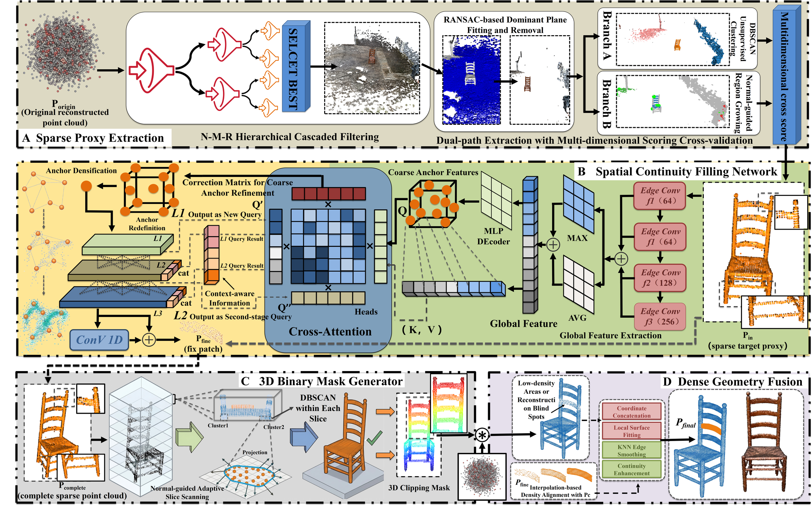
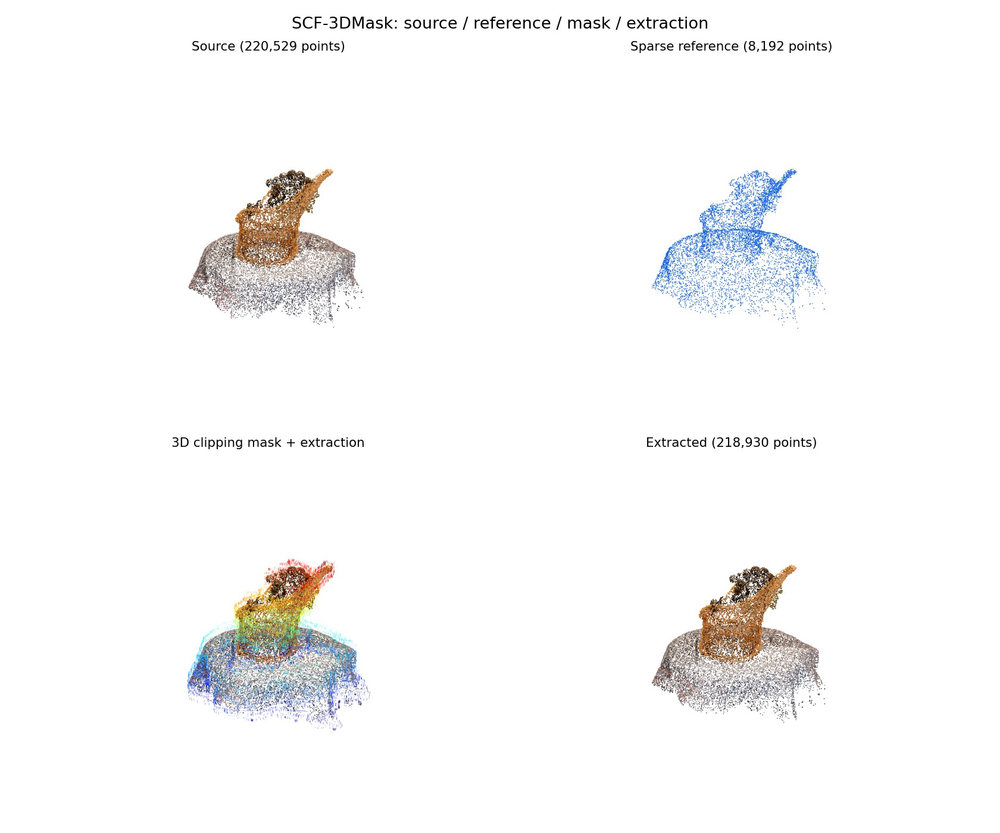
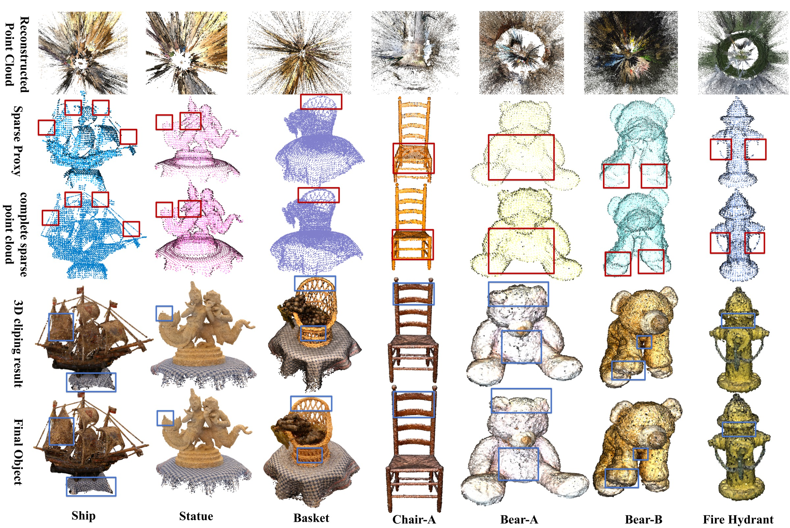
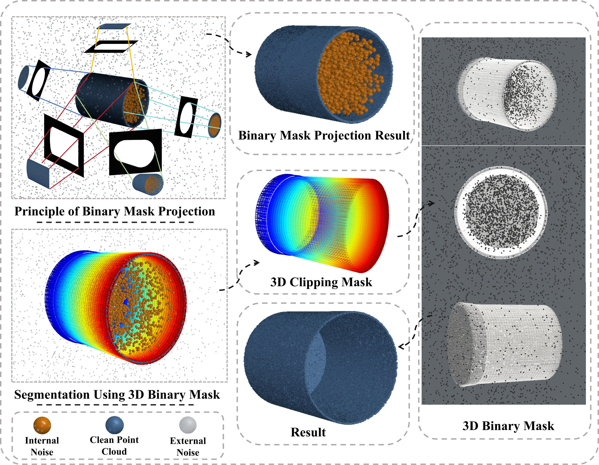
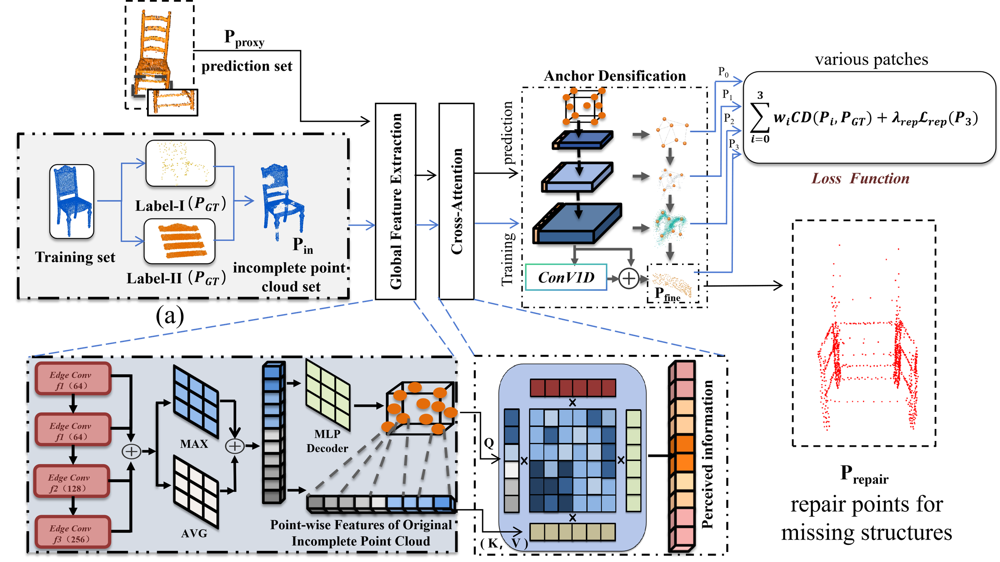
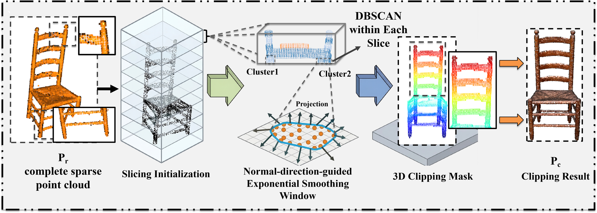
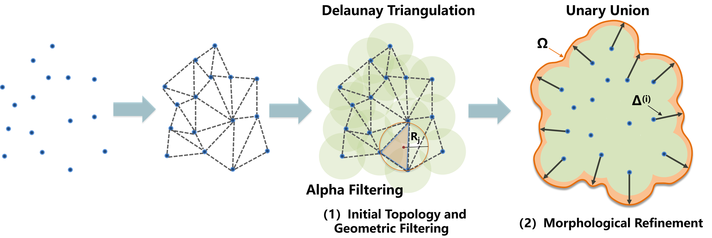
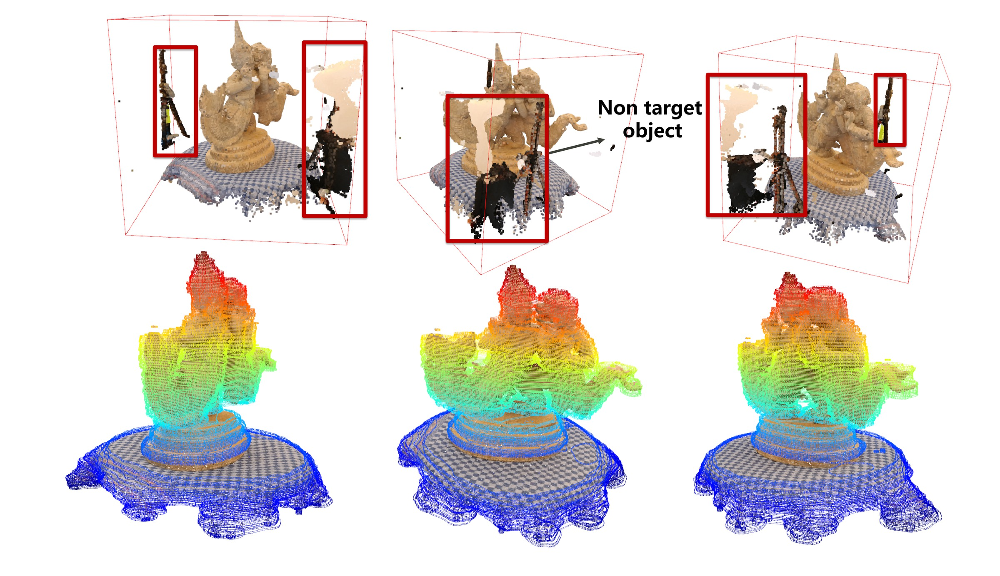
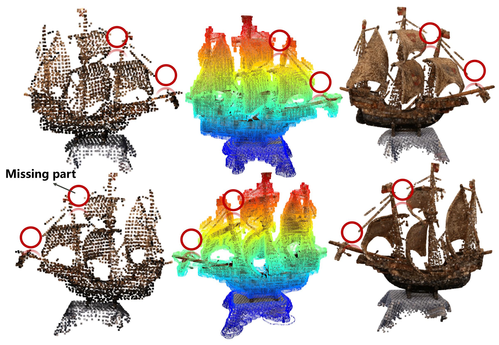

<div align="center">

# SCF-3DMask

### Spatial Continuity Filling Network and 3D Clipping Mask Generator<br>for Unsupervised 3D Object Recovery

**Recover object geometry from noisy reconstructed point clouds.**

Zikang Chen · Zihao Zhang · Huifang Hou · Zilin Liu · Qige Shi

[](#quick-start)
[](#quick-start)
[](https://www.open3d.org/)
[](LICENSE)

**[Quick Start](#quick-start) · [Results](#results) · [Method](#method) · [Datasets](#datasets) · [Documentation](#documentation) · [Citation](#citation)**



*Sparse proxy extraction → spatial continuity filling → 3D clipping → dense geometry fusion*

</div>

SCF-3DMask recovers a dense object point cloud from a noisy reconstruction without
manual object labels, category priors, or 2D segmentation masks. A sparse object
proxy guides a continuity filling network and slice-wise 3D clipping; the final
stage fuses extracted dense points with predicted repair patches.

| Continuity filling | Direct 3D clipping | Ready-to-run examples |
| :--- | :--- | :--- |
| Predict local repair patches for incomplete sparse geometry. | Build normal-guided slice masks in the reconstructed coordinate frame. | Five repair inputs, eight clipping inputs, and one example checkpoint. |

## Quick Start

Use **Python 3.10 or 3.11** for the initial setup. CPU inference is supported;
install the appropriate [PyTorch build](https://pytorch.org/get-started/locally/)
first if you need CUDA. The example commands below run from the repository root.

### 1. Get the examples

Clone the repository with Git LFS installed:

```bash
git lfs install
git clone https://github.com/zikangchen09-design/SCF-3DMask.git
cd SCF-3DMask
git lfs pull
python -m venv .venv
```

Activate the environment for your platform:

```powershell
# Windows PowerShell
.\.venv\Scripts\Activate.ps1
```

```bash
# Linux / macOS
source .venv/bin/activate
```

```bash
python -m pip install --upgrade pip
python -m pip install -e ".[visualization]"
```

Git LFS supplies the two largest PLY files and the example checkpoint. See the
[asset index](data/README.md) for sizes and checksums. Open3D's interactive viewer
requires a graphical desktop; the default clipping demo saves an image.

For the direct dependency versions used in the local CPU example checks, see
[requirements-demo.txt](requirements-demo.txt). They are a reproducibility
reference; CUDA builds and platform-specific packages may differ.

### 2. Try continuity filling

```bash
python scripts/test_repair_examples.py
```

The runner processes five incomplete clouds with the supplied example weight.
Each 8192-point input produces a **1024-point repair patch** and a **9216-point
repaired cloud**, saved under `outputs/repair_examples/` with a test report.

> 本项目提供基于少量拟合数据的示例权重和 5 份残缺点云，用于快速体验连续性填充网络。
> The 78.7 MiB checkpoint is fitted on a small amount of data for demonstration
> and interface testing. Use a trained experiment checkpoint for evaluation.

### 3. Try the 3D clipping mask

```bash
python scripts/test_mask_examples.py
```

The default runs **one case, `basket.ply`**, and saves a four-panel preview to
`outputs/mask_examples/basket/preview.png`. To also open the interactive viewer:

```bash
python scripts/test_mask_examples.py --case basket --visualize
```

<p align="center">
  
</p>

*Preview from the bundled basket demo. Its reference is sampled from the source
cloud; this illustrates the clipping interface, without a ground-truth accuracy
comparison. See [clipping examples](docs/mask_examples.md) for custom source/reference pairs.*

## Results

<p align="center">
  
</p>

*Paper illustration. Rows: original reconstruction, sparse proxy, continuity
filling, dense clipping, and final fusion. Boxes highlight local structures.*

## Method

| Stage | What it does | Implementation |
| :--- | :--- | :--- |
| **01 · Sparse proxy** | N-M-R filtering, clustering, and region scoring | [denoise.py](src/scf3dmask/denoise.py), [sparse_proxy.py](src/scf3dmask/sparse_proxy.py) |
| **02 · Continuity filling** | EdgeConv features, cross-attention, and progressive patch prediction | [repair/](src/scf3dmask/repair/) |
| **03 · 3D clipping** | Adaptive slice scanning and cross-sectional masks | [mask3d.py](src/scf3dmask/mask3d.py) |
| **04 · Dense fusion** | Merge extracted geometry and repair patches, then smooth boundaries | [fusion.py](src/scf3dmask/fusion.py) |

### Why a 3D mask?

A 2D silhouette constrains image position but can retain depth-ambiguous noise
inside hollow, concave, or semi-enclosed objects. SCF-3DMask builds extraction
constraints directly in 3D, supported by the repaired sparse proxy.

<p align="center">
  
</p>

<details>
<summary><strong>Spatial continuity filling network</strong></summary>

The network predicts repair points at 64, 256, 512, and 1024-point levels.
Self-supervised training constructs incomplete inputs and repair targets from
clean geometry. Exact layers and training transformations are defined in the
current [implementation](src/scf3dmask/repair/).



</details>

<details>
<summary><strong>3D clipping mask: module overview, slice construction, and examples</strong></summary>

#### Module overview

The repaired sparse reference initializes slicing along the Z axis. Within each
slice, DBSCAN separates local components, while a normal-direction-guided window
with exponential smoothing adapts the reference support across slices. Projected
points define cross-sectional polygons; the resulting 3D clipping constraints
select dense points from the original reconstruction, retaining their colors.



*Module overview: repaired sparse reference → slice initialization → local
clustering and normal-guided adaptive support → 3D clipping mask → dense result.
The original dense reconstruction supplies the points accepted by the mask.*

#### Cross-sectional construction and object examples

Projected slice points form cluster-level polygons, with adaptive buffering
providing cross-sectional support.



The statue example illustrates surrounding non-target structures and the clipping constraints.



The ship example shows sparse geometry, colored slice masks, and recovered dense geometry.



</details>

See the [illustrated method guide](docs/method_overview.md) for the figure-to-code map.

## Run on Your Own Data

Provide a reconstructed XYZ/RGB point cloud and a compatible repair checkpoint:

```bash
python scripts/run_pipeline.py --input path/to/scene.ply --output-dir outputs/my_scene --ckpt path/to/repair_model.pth
python scripts/view_results.py --final outputs/my_scene/05_final_object.ply
```

To run the geometry stages without repair:

```bash
python scripts/run_pipeline.py --input path/to/scene.ply --output-dir outputs/my_scene --skip-repair
```

Keep sources and reference clouds in the same coordinate frame. The mask slices
along Z; orient and scale the scene appropriately, and tune `--voxel-size` and
`--num-layers` for your reconstruction. See [usage and training](docs/usage.md)
for individual modules, outputs, and training commands.

### Start from photographs with Nerfstudio

```text
Multi-view photographs → Nerfstudio → point_cloud.ply → SCF-3DMask → recovered object
```

The supplied [Nerfstudio source](nerfstudio/nerfstudio-main/README.md) provides
the upstream reconstruction workflow. Process your images, train a reconstruction,
and export a point cloud before running SCF-3DMask.

**[Follow the image-to-point-cloud guide →](docs/nerfstudio_workflow.md)**

Nerfstudio can use a separate environment. The supplied PLY demos run directly,
without reconstructing images. Upstream source retains its Apache-2.0 license.

## Datasets

| Public dataset cited in the paper | Source |
| :--- | :--- |
| **CO3D-V2** | [Official repository and download instructions](https://github.com/facebookresearch/co3d) |
| **BlendedMVS** | [Official dataset repository](https://github.com/YoYo000/BlendedMVS) |
| **DTU MVS** | [Official dataset page](https://roboimagedata.compute.dtu.dk/?page_id=36) |
| **Dense Light Field · Yücer et al.** | [Original publication](https://doi.org/10.1145/2876504) |

Full public datasets are obtained from their upstream providers. The Dense Light
Field link is a publication landing page. The repository includes **five repair
inputs, eight clipping clouds, and one example weight** for trying the modules.
See [public dataset details](docs/datasets.md) and the [included asset index](data/README.md).

## Documentation

| Guide | Contents |
| :--- | :--- |
| [Usage and training](docs/usage.md) | Full pipeline, individual modules, training, and output files |
| [Repair examples](docs/repair_examples.md) | Checkpoint, CPU/CUDA inference, and checks |
| [Clipping examples](docs/mask_examples.md) | One-case demo, custom references, and visualization |
| [Nerfstudio workflow](docs/nerfstudio_workflow.md) | Photographs, reconstruction, and geometry export |
| [Data formats](docs/data_format.md) | Point-cloud and training input formats |
| [Script entry points](scripts/README.md) | Which core module each script calls |

<details>
<summary><strong>Repository layout</strong></summary>

```text
SCF-3DMask/
├── src/scf3dmask/           # algorithm implementations and repair network
├── scripts/                # command-line entry points and example runners
├── algorithms/             # standalone module entry points
├── data/examples/          # bundled point-cloud examples
├── checkpoints/examples/   # small-data-fitted example weight
├── docs/                   # guides and method illustrations
├── nerfstudio/             # supplied upstream reconstruction source
└── outputs/                # generated artifacts, ignored by Git
```

Wrappers in `scripts/` and `algorithms/` import the reusable implementations in
`src/scf3dmask/`. Install the package before running these entry points.

</details>

## Citation

If you use this work, please cite the SCF-3DMask manuscript:

```bibtex
@article{scf3dmask2026,
  title={SCF-3DMask: Spatial Continuity Filling Network and 3D Clipping Mask Generator for Unsupervised 3D Object Recovery},
  author={Chen, Zikang and Zhang, Zihao and Hou, Huifang and Liu, Zilin and Shi, Qige},
  year={2026}
}
```

## License and Acknowledgements

SCF-3DMask code is released under the [MIT License](LICENSE). Nerfstudio retains
its [Apache-2.0 license](nerfstudio/nerfstudio-main/LICENSE); public datasets remain
subject to their upstream terms. See [third-party acknowledgements](THIRD_PARTY.md).
