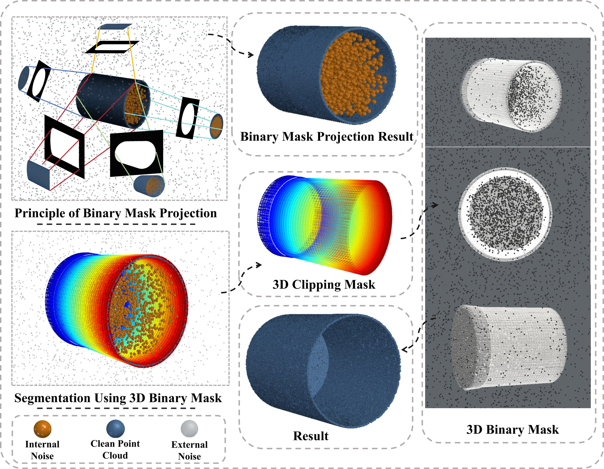
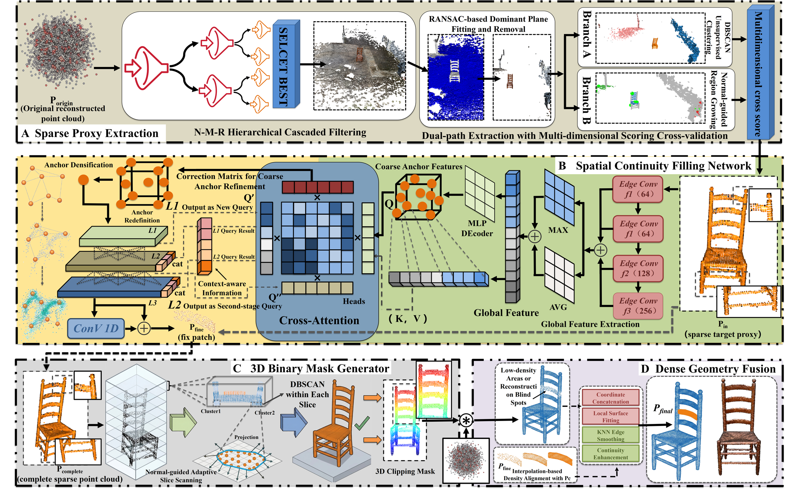
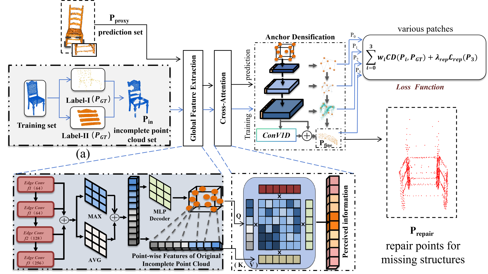
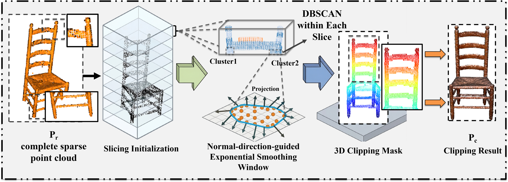
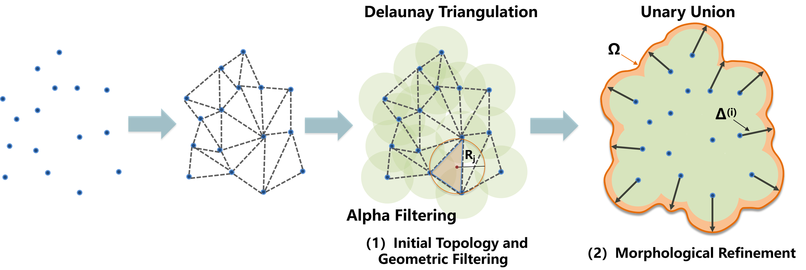
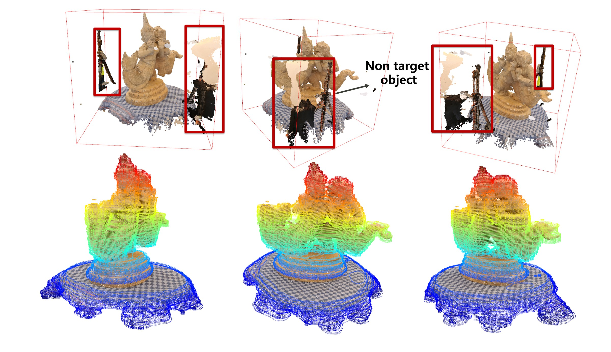
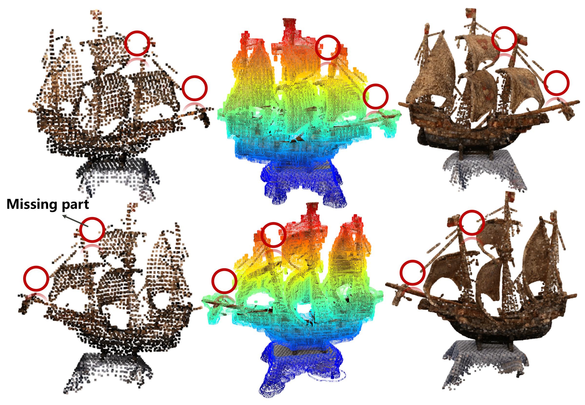
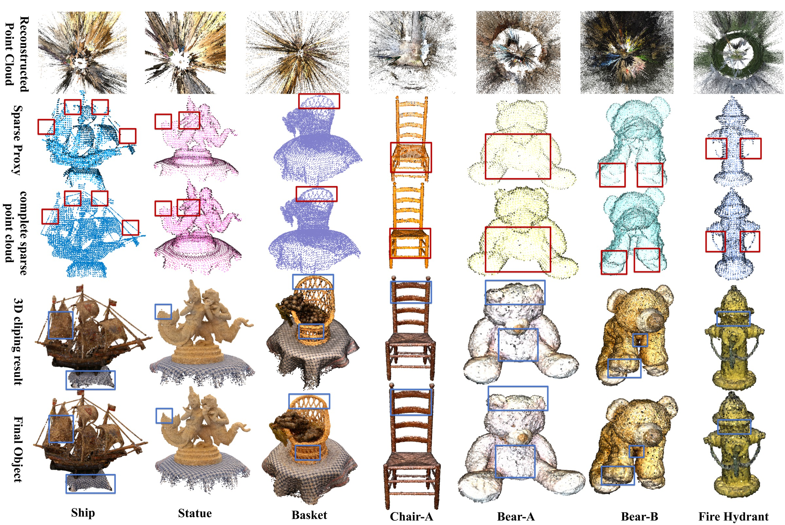

# Method Overview

SCF-3DMask targets post-reconstruction object recovery. It assumes a noisy point
cloud has already been reconstructed by SfM/MVS, NeRF, 3DGS, or a related
pipeline.

## Paper figures and implementation map

| Original figure | Meaning | Code / guide |
| --- | --- | --- |
| 图片5 | 2D projection ambiguity and 3D clipping motivation | `mask3d.py` |
| 图片6 | Four-stage framework | `pipeline.py` |
| 图片1 | Continuity filling network | `repair/model.py`, `repair/dataset.py`, `repair/loss.py` |
| 图片4 | Slice-wise polygon construction | `mask3d.adaptive_cluster_polygon` |
| 图片2 | Ship recovery and colored mask | Clipping and fusion |
| 图片3 | Non-target structures and 3D clipping | Clipping |
| 图片7 | Stage-wise qualitative recovery | Full pipeline |
| 图片8 | 3D clipping mask module overview | `mask3d.generate_3d_binary_mask` |

Publication figures are supplied as smaller, white-background images in
`docs/photo/readme/`. The figures illustrate
the paper method; concrete layer definitions, default parameters, and training
transformations are defined by the current source implementation.

## Sparse Proxy Extraction

The N-M-R stage searches over statistical outlier removal, radius outlier
removal, and cascaded radius filtering branches. Branches are scored by density
consistency, normal smoothness, and retention ratio. The best branch is then
processed by plane removal, DBSCAN clustering, normal-guided region growing, and
multi-dimensional scoring.

## Spatial Continuity Filling

The network receives a sparse object proxy and predicts a 1024-point repair
patch. It uses EdgeConv local encoding, cross-attention from generated anchors
to input features, and a coarse-to-fine cascade:

- 64 anchors
- 256 level-1 points
- 512 level-2 points
- 1024 refined repair points

Training is self-supervised. Clean point clouds are damaged by simulated
filtering and local patch removal; removed points become the repair labels.

The encoder in the current implementation uses two EdgeConv blocks (64 and 128
channels), followed by a 256-channel pointwise convolution. The schematic is
provided as the paper illustration; use the model code for exact layer details.

## 3D Binary Mask

The repaired sparse reference is sliced along the Z axis. Each slice estimates a
normal-guided expansion window, clusters projected reference points, builds
AlphaShape polygons, and extracts original dense points inside the slice mask.
This avoids the depth ambiguity of 2D binary masks.

## Dense Fusion

The final stage merges mask-extracted dense points with predicted repair
patches. Patch points are locally upsampled and gently blended near dense-cloud
boundaries to reduce stitching gaps.

